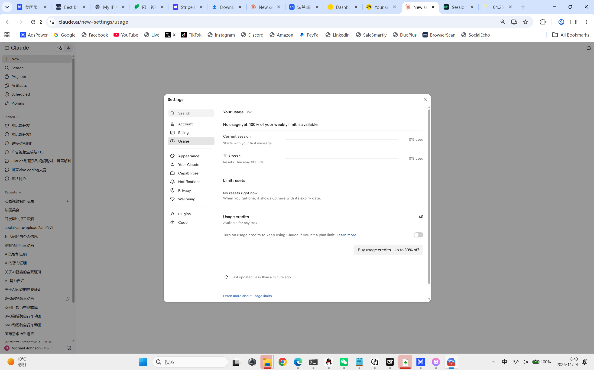
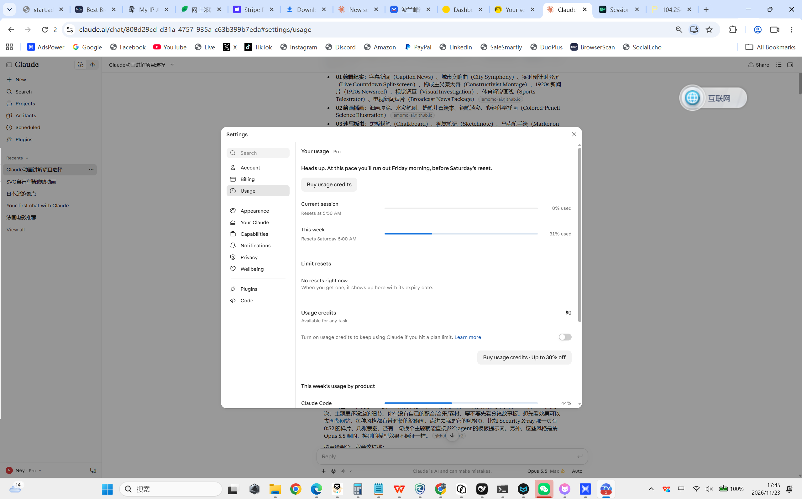
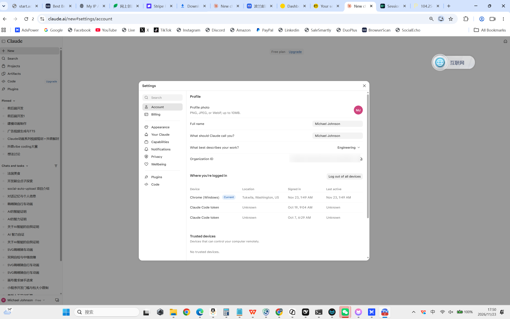

# Claude Anti-Ban Skill

[简体中文](README.md) ｜ English

**Free & open source ｜ Author: future ｜ Version: 2026.11 ｜ License: MIT**

A field-tested playbook for keeping Claude accounts alive: picking a genuine US residential IP, building a Clash chain proxy, plugging DNS/IPv6 leaks, configuring the AdsPower fingerprint browser, warming up an account, choosing a payment route, running Claude Code remotely, and self-checking after a ban.

> This is **a method**, not a guarantee. Whether an account survives depends on execution, account origin, whether IP / payment / KYC are consistent, and the platform's own policy.

---

## Download

- **Latest (always points to the newest build)**: https://github.com/futureYYY/claude-antiban-skill/releases/latest/download/claude-antiban-skill-latest.zip
- All versions: https://github.com/futureYYY/claude-antiban-skill/releases

## One line for your AI agent (copy this)

> Using https://github.com/futureYYY/claude-antiban-skill, set up a stable Claude environment from scratch and walk me through it step by step.

Send it to your agent (WorkBuddy / Qoder / Cursor / Codex …). It will clone the repo and follow it.

---

## What's inside

```
claude-antiban-2026/
├── SKILL.md                        Main manual: principles, phases, acceptance criteria
├── 00-START-HERE.md                17-step script, follow in order
├── AGENTS.md                       Hard rules for AI agents
├── references/
│   ├── 01-server-and-ip.md         Server selection & 5-point residential IP check
│   ├── 02-chain-proxy-and-dns.md   Chain proxy and DNS leaks
│   ├── 03-browser-fingerprint.md   AdsPower setup, item by item
│   ├── 04-account-and-payment.md   Registration, warming, payment (updated 2026-11)
│   ├── 05-claude-code-remote.md    Claude Code on the server, used remotely
│   ├── 06-redlines-and-lessons.md  What actually gets accounts banned
│   ├── 07-agent-protocol.md        Four-part format for reporting blockers
│   └── 09-mobile.md                Mobile device (optional)
├── scripts/                        10 runnable scripts
├── assets/qr/                      Donation & contact QR codes
└── MANIFEST.sha256                 Integrity manifest (27 files)
```

---

## How to use

**Option 1 — hand it to an AI (recommended)**

Give the folder to WorkBuddy / Qoder / Cursor / Codex and say the one-liner above. The agent reads `AGENTS.md` first, then runs Steps 1→17 from `00-START-HERE.md`. You only show up for payments, SMS verification, ID documents, and UAC prompts.

**In practice**: nothing is installed locally — a coding agent such as Qoder sends commands over SSH to the Claude instance running on the server.

**Option 2 — do it yourself**

1. Read `00-START-HERE.md`, follow the steps in order
2. Each step tells you what to do, how long it takes, what you should see, and where to look when stuck
3. Principles and criteria live in `references/`

**Install location**

- Claude Code: `~/.claude/skills/claude-antiban-2026/`
- Qoder: `~/.qoder/skills/claude-antiban-2026/`

---

## Update 2026-11-24

- Multi-account quota rotation: two Pro accounts hand off automatically at 10–20% remaining
- Each round draws X=10–20: switch at X% remaining and probe every X minutes; 30-minute dwell; wait for reset + 30–60 min when both are tight
- Resume sends "继续" only to unfinished sessions, sequentially, 5–10 s apart
- Restarts preserve the original `--model / --effort`
- See `references/10-quota-switching.md` and `scripts/quota-guard2.sh`

## Subscription log (2026-11-23)

**Around 10 PM on 2026-11-23, the expired Max account was renewed to Pro through Google Play.**

> Ignore the clock in the phone screenshot: the system time zone was switched to match the US.

<p>
  <a href="assets/proof/renewal-2026-11-23.png" target="_blank"></a>
</p>

Screen recording of the whole flow (1 minute, Google Play payment through to Pro activation):

https://github.com/futureYYY/claude-antiban-skill/releases/download/v2026.11.24/immersive-subscribe.mp4

## Field evidence

As of 2026-11-23, both accounts are still alive:

- One **Pro** account went through a renewal (31% of this week's usage; Claude Code 44%)
- The other account, originally **Max**, was not renewed and now shows as **Free**

<p>
  <a href="assets/proof/pro-usage-v4.png" target="_blank"></a>
  <a href="assets/proof/max-to-free-v4.png" target="_blank"></a>
</p>

> Name and organization ID are blurred; dates and plan status are untouched.

## Important update (2026-11)

Anthropic tightened risk control. Accounts topped up via **third-party resellers + iOS in-app purchase** now fail to credit noticeably more often; even when it works, the subscription is tied to someone else's payment chain, and a chargeback can kill both the subscription and the account.

Two relatively safe routes:

1. **Your own Visa / Mastercard + Google Play** — on a phone, set the Play payment region to Japan, bind your own card, install Claude from Google Play, then subscribe in-app
2. **Buy a ready-made account** — only ones whose email can be changed and rebound; change password and recovery email the next day after a full 24 hours

See `references/04-account-and-payment.md`.

---

## Integrity check

```bash
cd claude-antiban-2026
sha256sum -c MANIFEST.sha256
```

All `OK` means untouched. Any `FAILED` means the files were modified — re-download from [GitHub Releases](https://github.com/futureYYY/claude-antiban-skill/releases).

---

## Support the work

Making this skill took real effort. If it helps you, you're welcome to leave a tip — any amount, entirely voluntary.

<p>
  
  
</p>

---

## Contact & services

Add me on WeChat to talk about the full anti-ban chain. I also provide **paid** end-to-end setup and single-step delivery services.

WeChat ID: **future_qyf** (or scan below)

More notes and field records: https://tokendock.online/

<p></p>

---

## Boundaries

- This skill is **completely free and open source**. Tips are voluntary and do not constitute purchase of any service; one-on-one services are discussed separately.
- Prices mentioned in the docs are **market references** and fluctuate; services quoted separately.
- Users are responsible for complying with local laws and platform terms.

---

## License

MIT, see [LICENSE](LICENSE). Please credit the author when redistributing.
