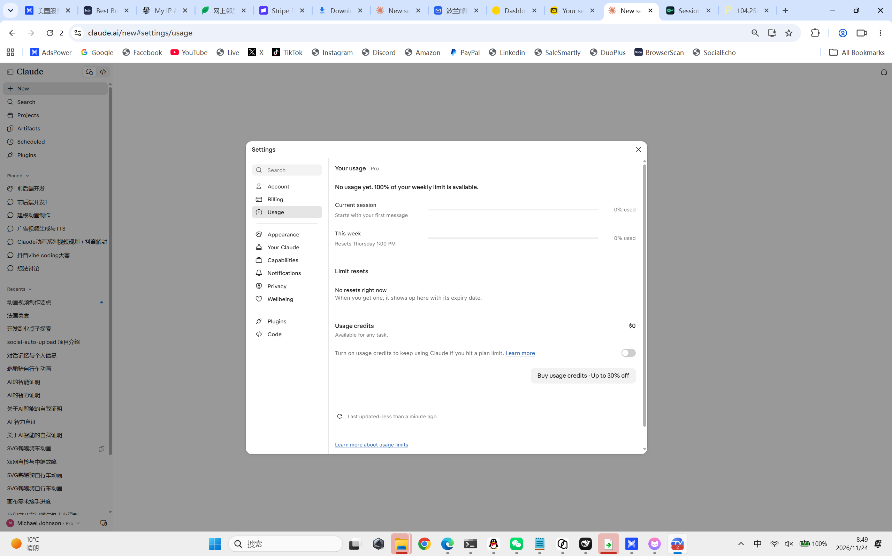
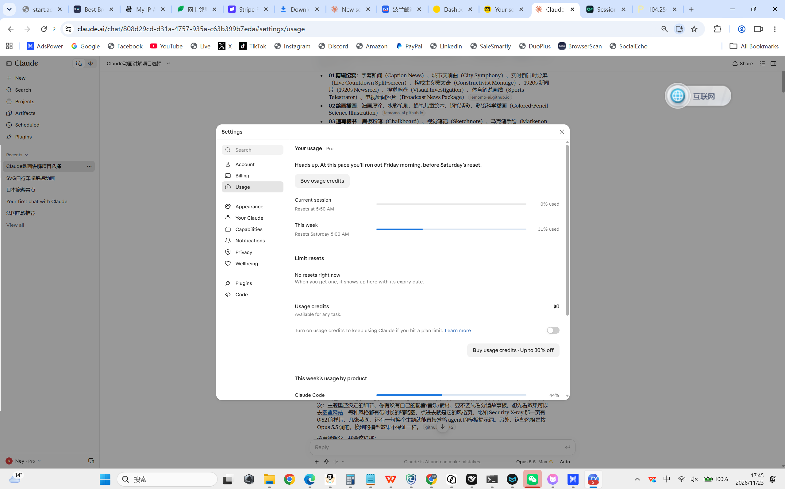
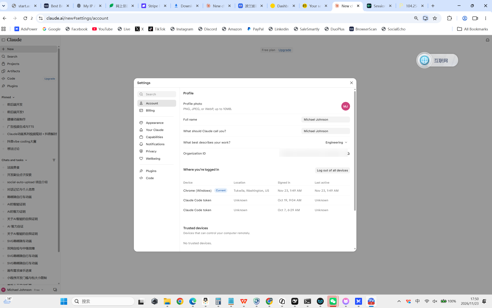

# Claude 防封 skill

简体中文 ｜ [English](README.en.md)

一套实测跑通的 Claude 账号防封全链路手册：从挑选美国住宅 IP、搭 Clash 链式代理、堵 DNS / IPv6 泄漏、配置 AdsPower 指纹环境，到注册养号、订阅支付、Claude Code 远程使用，以及被封之后的自查顺序。

> 它记录的是「一套方法」，**不是「保证不被封」的承诺**。账号是否被封取决于执行是否到位、账号来源、IP / 支付 / KYC 是否同源，以及平台策略。

---

## 给 AI agent 的一句话（直接复制）

> 从 github 上安装此 skill：https://github.com/futureYYY/claude-antiban-skill ，把 Claude 稳定使用的环境从零搭起来，一步步带我走。

发给你的 agent（WorkBuddy / Qoder / Cursor / Codex 都行）即可，它会自己把仓库拉下来照着跑。

<details>
<summary>agent 看到这句时该怎么做</summary>

1. `git clone https://github.com/futureYYY/claude-antiban-skill`（拉不下来就让用户给 zip，解压后同样处理）
2. 读 `AGENTS.md`（硬规则）和 `00-START-HERE.md`（Step 1→17 剧本）
3. 一步一步执行，每步都要跑出「你会看到什么」里的判据才算通过，不许跳步
4. 能自己做的全部自己做，只在付款、手机接码、证件自拍、UAC 弹窗这四类事情上找用户
5. 卡住时按 `references/07-agent-protocol.md` 的四段式回报：【卡在 Step N】/ 现状 / 判定 / 需要你 / 拿到之后我会

</details>

---

## 包含什么

```
claude-antiban-2026/
├── SKILL.md                        主手册：原理、阶段划分、判据
├── 00-START-HERE.md                17 步剧本，照着做即可
├── AGENTS.md                       交给 AI agent 的硬规则与完成定义
├── references/
│   ├── 01-server-and-ip.md         服务器选型与住宅 IP 五项验收
│   ├── 02-chain-proxy-and-dns.md   链式代理与 DNS 泄漏
│   ├── 03-browser-fingerprint.md   AdsPower 指纹逐项配置
│   ├── 04-account-and-payment.md   注册、养号、订阅与支付（2026-11 更新）
│   ├── 05-claude-code-remote.md    Claude Code 只装服务器、本机远程用
│   ├── 06-redlines-and-lessons.md  真正会封号的行为
│   ├── 07-agent-protocol.md        卡住时怎么向你回报（四段式）
│   └── 09-mobile.md                手机端（可选）
├── scripts/                        10 个可直接运行的脚本
│   ├── check-ip-quality.sh         IP 质量五项检测
│   ├── check-chain.sh              验证流量真的走了中转
│   ├── check-dns-leak.sh           DNS 泄漏检测
│   ├── harden-server.sh            服务器加固
│   ├── install-ss.sh               装 shadowsocks
│   ├── ssh-guard.sh                连服务器前的硬闸门
│   ├── ensure-ssh-proxy.sh         给 SSH 钉上代理
│   ├── weekly-check.sh             每周自查
│   ├── claude-safe                 远程跑 Claude Code
│   └── cc
└── assets/qr/                      打赏与联系方式二维码
```

---

## 怎么用

**方式一：交给 AI（推荐）**

把整个目录丢给 WorkBuddy / Qoder / Cursor / Codex 等能跑命令的 agent，说一句：

> 从 github 上安装此 skill：https://github.com/futureYYY/claude-antiban-skill ，把 Claude 稳定使用的环境从零搭起来，一步步带我走。

agent 会先读 `AGENTS.md`，再按 `00-START-HERE.md` 的 Step 1 → 17 执行；你只在付款、收验证码、出证件的时候出现。

**实际用法**：本机不装 Claude Code，用 Qoder 这类 agent 下发指令，通过 SSH 让服务器上的 Claude 执行任务。

**方式二：自己动手**

1. 读 `00-START-HERE.md`，按 Step 顺序做
2. 每步都有「做什么 / 多久 / 你会看到什么 / 卡住看哪」
3. 原理和判据查 `references/`

**安装位置**

- Claude Code：`~/.claude/skills/claude-antiban-2026/`
- Qoder：`~/.qoder/skills/claude-antiban-2026/`

---

## 2026-11-24 更新

- 新增 **多账号额度轮换**：两个 Pro 号自动顶班，剩余 10–20% 就切
- 阈值每次重抽、切换后驻留 30 分钟、双号都满时等重置 + 30–60 分钟
- 续跑只发「继续」给未完成的会话，串行、间隔 5–10 秒
- 重启保留原 `--model / --effort`
- 详见 `references/10-quota-switching.md` 与 `scripts/quota-guard2.sh`

## 订阅实录（2026-11-23）

**2026-11-23 晚上 10 点左右，通过 Google Play 给过期的 Max 账号续订了 Pro。**

> 手机截图上的时间请忽略：系统时区已改为与美国一致。

<p>
  <a href="assets/proof/renewal-2026-11-23.png" target="_blank"></a>
</p>

订阅全程录屏（1 分钟，沉浸式走一遍 Google Play 付款到 Pro 到账）：

https://github.com/futureYYY/claude-antiban-skill/releases/download/v2026.11.24/immersive-subscribe.mp4

## 实测记录

截至 2026-11-23，两个账号都还活着：

- 一个 **Pro** 号经历了续期（本周用量 31%，Claude Code 44%）
- 另一个原本 **Max** 的账号没有续期，现在显示为 **Free**

<p>
  <a href="assets/proof/pro-usage-v4.png" target="_blank"></a>
  <a href="assets/proof/max-to-free-v4.png" target="_blank"></a>
</p>

> 截图已隐去姓名与组织 ID，日期和套餐状态未做改动。

## 2026-11 重要更新

官方风控进一步收紧，通过**第三方代充 + iOS 渠道**充值的账号，**订阅不到账**的概率明显上升；即便到账，代充绑的是别人的支付链，一旦拒付或回溯，订阅作废、账号连带封禁。

当前相对稳妥的两条路：

1. **自备国内 Visa / Mastercard + Google Play 订阅** —— 手机端操作，付款地区选日本，绑定自己的卡即可；作者本人的 Pro 续费就是这条路径，详见 `references/04-account-and-payment.md`
2. **买成品号** —— 只买能改邮箱、能换绑的；到手当天先正常用，满 24 小时后第二天再改密码与恢复邮箱

详见 `references/04-account-and-payment.md`。

---

## 完整性校验

下载后先验一遍，确认没被第三方改过：

```bash
cd claude-antiban-2026
sha256sum -c MANIFEST.sha256
```

全部 `OK` 即原版。出现 `FAILED` 说明文件被改过，请从 [GitHub Releases](https://github.com/futureYYY/claude-antiban-skill/releases) 重新下载。


## 打赏

制作这份 skill 不易，如果它对你有帮助，可以根据自己的实际情况进行打赏，作者感激不尽。

<p>
  
  
</p>

---

## 联系与服务

加我好友沟通，了解防封全链路，也提供全链路防封服务或者单环节交付服务。

微信号：**future_qyf**（也可直接扫下方二维码）

更多实测记录与说明：https://tokendock.online/

<p></p>

---

## 边界声明

- 本 skill **完全免费开源**，打赏纯属自愿，不构成任何服务购买或交付承诺；一对一服务请单独沟通。
- 文中出现的服务器、机场、KYC 等价格均为**市场参考价**，随行情波动；作者提供的服务以实际报价为准。
- 使用者需自行确认所在地区的法律法规与平台条款，因使用产生的后果由使用者自行承担。

---

## 许可

MIT License，详见 [LICENSE](LICENSE)。转载请注明出处。
